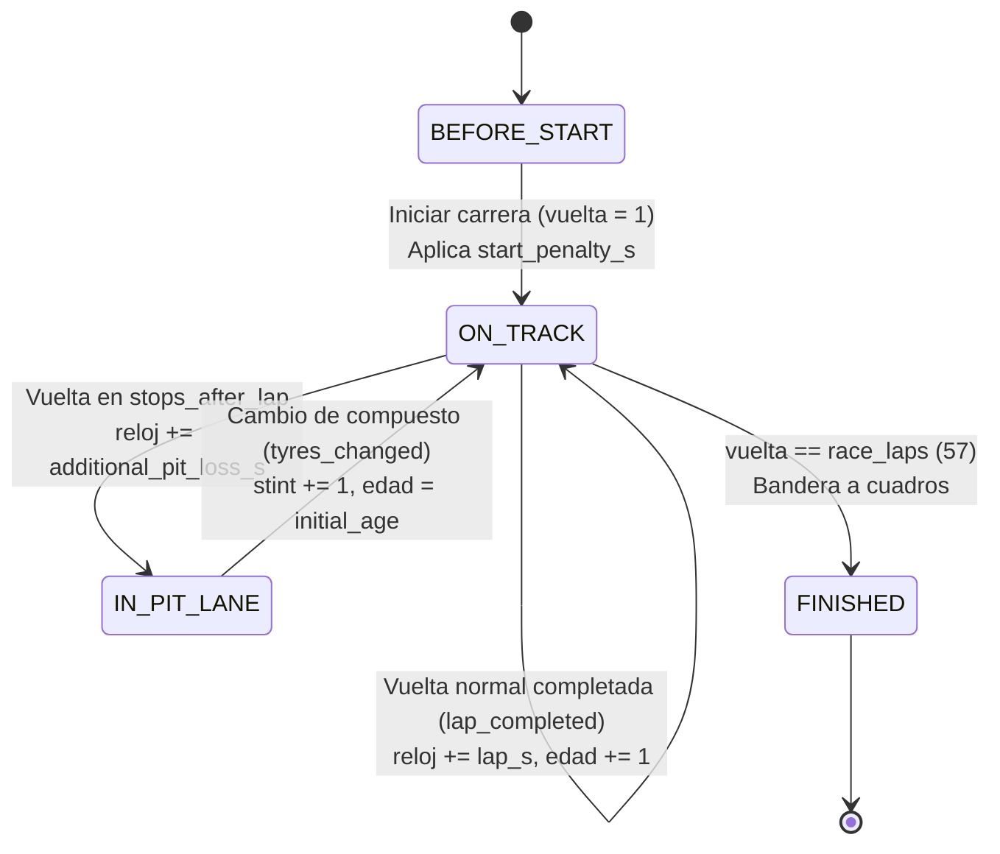

# Formulación del Modelo y Simulador de Carrera (JO-01, JO-02, JO-03)

**Responsable:** Jonathan Zacarias.  
**Revisión pendiente:** Ihan Marroquin (IH-05), Mario Fernando Rocha (MA-04) y Luis Pedro Lira (LP-02, LP-03).  
**Fecha:** 2026-11-06.  
**Código:** `src/model.py`, `src/simulation.py`.  
**Pruebas:** `tests/test_model.py`, `tests/test_core.py`.  
**Comandos:** `python main.py simulate`, `python main.py simulate --stochastic --seed 42`, `python -m unittest discover -s tests -v`.  
**Salidas generadas:** `results/simulation/bahrain_2024_simulation.json`, `results/simulation/bahrain_2024_laps.csv`.

---

## 1. Diagrama de Estados y Flujo de Eventos (JO-01)

El simulador implementa un modelo de **simulación por eventos discretos** (DES) con reloj global continuo en segundos ($t$), donde los eventos principales son el avance de vuelta (`lap_completed`), la detención en boxes (`pit_stop` / `tyres_changed`) y la bandera a cuadros (`race_finished`).



### Variables de Estado

| Variable | Tipo | Unidad | Definición |
|---|---|---|---|
| `lap` | `int` | vueltas | Índice de la vuelta actual en carrera ($1 \le lap \le 57$). |
| `stint_index` | `int` | índice | Stint actual en curso ($0, 1, 2$). |
| `compound` | `str` | compuesto | Neumático en uso (`SOFT` o `HARD`). |
| `tyre_age` | `int` | vueltas | Vueltas acumuladas por el juego de neumáticos al terminar la vuelta actual. |
| `clock_s` | `float` | segundos | Tiempo transcurrido acumulado de carrera. |
| `cumulative_pit_loss_s` | `float` | segundos | Tiempo total acumulado por pérdidas adicionales de paradas. |

---

## 2. Formulación Matemática Completa (JO-01)

### Ecuación de Vuelta Normal
Para una vuelta lanzada bajo bandera verde sin incidentes de carrera:

$$t_{\text{normal}}(l, c, a) = b_c + d_c \cdot a \cdot \mu_{\text{deg}} + g \cdot (l - 1)$$

Donde:
- $b_c$: Tiempo base del compuesto $c$ en segundos ($s$). Representa el ritmo de referencia de un juego nuevo ($a = 0$) en la vuelta inicial de carrera ($l = 1$).
- $d_c$: Tasa de degradación del compuesto $c$ en segundos por vuelta de edad ($s/\text{vuelta}$).
- $a$: Edad del juego al terminar la vuelta ($a = a_{\text{init}} + \text{vuelta\_en\_stint}$).
- $\mu_{\text{deg}}$: Multiplicador de degradación (adimensional). En el caso base $\mu_{\text{deg}} = 1.0$; en los escenarios de sensibilidad (Condiciones C y D del plan) $\mu_{\text{deg}} = 1.20$.
- $g$: Tendencia lineal de carrera en segundos por vuelta ($s/\text{vuelta}$), capturando la ganancia de ritmo por consumo de combustible y evolución de pista.
- $(l - 1)$: Desplazamiento temporal respecto al inicio de la carrera, asegurando que $g$ no altere el intercepto $b_c$ en la vuelta 1.

### Ecuación de Vuelta en Carrera
Para la vuelta $l$:

$$t_{\text{lap}}(l) = t_{\text{normal}}(l, c, a) + \Delta t_{\text{start}}(l) + \epsilon_l$$

Donde:
- $\Delta t_{\text{start}}(l)$: Penalización por partida detenida (s), aplicada exclusivamente en $l = 1$:
  $$\Delta t_{\text{start}}(l) = \begin{cases} \text{start\_penalty\_s} & \text{si } l = 1 \\ 0 & \text{si } l > 1 \end{cases}$$
- $\epsilon_l$: Término de ruido residual estocástico:
  $$\epsilon_l \sim \mathcal{N}(0, \sigma^2) \quad \text{si stochastic=True; } \epsilon_l = 0 \text{ si deterministic}$$
  con $\sigma = \text{residual\_sd\_s} = 0.1631\text{ s}$, obtenido de la dispersión de residuos del entrenamiento.

### Tiempo Transcurrido por Vuelta y Reloj Acumulado
Si la vuelta $l$ corresponde a una vuelta de entrada a boxes ($l \in \text{stops\_after\_lap}$):

$$t_{\text{elapsed}}(l) = t_{\text{lap}}(l) + \Delta t_{\text{pit}}(l)$$

con $\Delta t_{\text{pit}}(l) = \text{additional\_pit\_loss\_s}$ (25.5223 s). El reloj global de carrera evoluciona:

$$T(L) = \sum_{l=1}^L t_{\text{elapsed}}(l)$$

---

## 3. Identificabilidad y Separación entre Desgaste y Tendencia (JO-01)

En la partición aprobada (MA-03), el entrenamiento contiene únicamente las 33 vueltas de los stints 1 y 2. Como cada compuesto aparece en un solo stint:
- En stint 1 (SOFT): $\text{edad} = l + 3$.
- En stint 2 (HARD): $\text{edad} = l - 17$.

La edad y el avance de carrera son **estrictamente colineales** dentro de cada stint. La matriz de diseño tiene rango 4 para 5 parámetros (`base_SOFT`, `base_HARD`, `deg_SOFT`, `deg_HARD`, `tendencia`).

**Decisión metodológica rigurosa:**
No se fuerza una estimación espuria de la tendencia con los datos de entrenamiento. En su lugar, se fija la tendencia con la referencia externa del simulador de TUM (Heilmeier et al., 2018; parámetros de Sakhir 2019):

$$g_{\text{ref}} = -(0.023\text{ s/kg} \times 1.93\text{ kg/vuelta}) = -0.0444\text{ s/vuelta}$$

Se evalúan además dos escenarios de sensibilidad preregistrados:
1. `trend_zero` ($g = 0.0$ s/vuelta): Todo el cambio de ritmo se atribuye al desgaste.
2. `trend_double` ($g = -0.0888$ s/vuelta): Combustible más evolución térmica/goma de igual magnitud.

---

## 4. Modelado de Arranque, Paradas y Juegos Usados (JO-02)

### Penalización de Arranque
- **Vuelta 1 observada oficial (Jolpica / FIA):** $97.284\text{ s}$ (`docs/conciliacion_tiempos.md`).
- **Vuelta 1 lanzada predicha (SOFT, edad inicial 3 + 1 = 4):**
  $$t_{\text{normal}}(1, \text{SOFT}, 4) = 96.4140 + 0.0761 \times 4 - 0.0444 \times 0 = 96.7184\text{ s}$$
- **Penalización calculada:**
  $$\text{start\_penalty\_s} = 97.2840 - 96.7184 = 0.5656\text{ s}$$
- **Verificación:** En simulación, la vuelta 1 suma $96.7184 + 0.5656 = 97.2840\text{ s}$, reproduciendo exactamente la observación oficial.

### Pérdida Adicional de Parada en Boxes (Sin Doble Conteo)
En una parada real en boxes se ven afectadas dos vueltas: la vuelta de entrada (`in-lap`, vuelta 17) y la vuelta de salida (`out-lap`, vuelta 18).

| Vuelta | Observado | Normal predicho | Exceso observado |
|---|---:|---:|---:|
| 17 (`in-lap`) | 99.896 s | 97.2256 s | +2.6704 s |
| 18 (`out-lap`) | 117.854 s | 95.0024 s | +22.8516 s |
| **Suma (17 + 18)** | **217.750 s** | **192.228 s** | **+25.5220 s** |

**Convención del simulador:**
- La penalización total ($25.5223\text{ s}$) se aplica como una pérdida agrupada al reloj al terminar la vuelta 17.
- La vuelta 18 se modela como una vuelta normal con neumáticos nuevos ($\text{edad} = 1$).
- **Suma simulada vueltas 17 y 18:**
  $$t_{\text{sim}}(17) + t_{\text{sim}}(18) = (97.2256 + 25.5223) + 95.0024 = 217.7503\text{ s}$$
- **Diferencia contra observado:** $+0.0003\text{ s}$ (redondeo numérico).

> [!IMPORTANT]
> **No existe doble conteo:** El exceso del `out-lap` (los ~22.85 s de circular por el pit lane, cambio de gomas y tracción en frío) ya está contenido dentro de `additional_pit_loss_s`. El simulador no agrega retardos de calentamiento adicionales en la vuelta 18.

### Convención de Juegos Usados
- `TyreStint.initial_age` almacena las vueltas previas del juego antes del stint.
- Para Max Verstappen en Bahréin 2024:
  - Stint 1: `SOFT`, `initial_age = 3` (juego usado en Q3). En vuelta 1 su edad es 4, en vuelta 17 su edad es 20.
  - Stint 2: `HARD`, `initial_age = 0` (juego nuevo). En vuelta 18 su edad es 1, en vuelta 37 su edad es 20.
  - Stint 3: `SOFT`, `initial_age = 0` (juego nuevo). En vuelta 38 su edad es 1, en vuelta 57 su edad es 20.

---

## 5. Simulación de la Carrera Completa y Resultados (JO-03)

### Parámetros Reales Conectados (`configs/params_bahrain_2024.json`)

```json
{
  "compounds": {
    "HARD": { "base_lap_s": 95.6518, "degradation_s_per_lap": 0.1052 },
    "SOFT": { "base_lap_s": 96.4140, "degradation_s_per_lap": 0.0761 }
  },
  "race_trend_s_per_lap": -0.0444,
  "additional_pit_loss_s": 25.5223,
  "start_penalty_s": 0.5656,
  "residual_sd_s": 0.1631
}
```

### Resultados de la Simulación de Bahréin 2024

| Escenario | Tiempo Total Simulado | Referencia Oficial FIA | Diferencia | Stint 1 (17 v) | Stint 2 (20 v) | Stint 3 (20 v) |
|---|---:|---:|---:|---:|---:|---:|
| `trend_fuel_reference` (Principal) | **5514.699 s** | 5504.742 s | **+9.957 s** | 1674.612 s | 1937.118 s | 1902.969 s |
| `trend_zero` (Sensibilidad) | 5550.219 s | 5504.742 s | +45.477 s | 1674.612 s | 1937.118 s | 1938.489 s |
| `trend_double` (Sensibilidad) | 5479.179 s | 5504.742 s | −25.563 s | 1674.612 s | 1937.118 s | 1867.449 s |

### Desglose de la Diferencia (+9.957 s)
1. En los stints 1 y 2 (vueltas 1 a 37, datos de entrenamiento y eventos de parada), el modelo reproduce casi exactamente los tiempos observados debido al ajuste OLS. La duración de los stints 1 y 2 es **exactamente idéntica** en los tres escenarios de tendencia.
2. Toda la discrepancia de +9.957 s se origina en el **Stint 3 (vueltas 38 a 57)**, el cual fue reservado íntegramente para validación temporal independiente (MA-03).
3. En el stint 3 real, Verstappen administró una ventaja de más de 20 segundos y marcó la vuelta rápida en la vuelta 39 (1:32.608 = 92.608 s), un ritmo significativamente más veloz que la proyección lineal del modelo.
4. Siguiendo las directrices éticas del proyecto, **no se ajustaron parámetros con los datos del stint 3** para maquillar el error de reconstrucción. La validación formal de este error le corresponde a Luis Pedro Lira en LP-03.

---

## 6. Modo Estocástico y Variabilidad (JO-03)

- El modo estocástico agrega perturbaciones Gaussianas independientes $\epsilon_l \sim \mathcal{N}(0, 0.1631^2\text{ s}^2)$.
- Genera variabilidad realista de carrera preservando reproducibilidad estricta mediante control de semilla (`seed`).
- **Autocorrelación residual observada:** Mario midió autocorrelación de orden 1 de 0.21 en SOFT y 0.00 en HARD (`docs/calibracion.md`). El modelo actual asume independencia como aproximación parsimoniosa justificada.

---

## 7. Verificación Técnica

- Se implementaron 9 pruebas unitarias especializadas en `tests/test_model.py`.
- Se verificó que todas las 59 pruebas del repositorio pasan sin fallos:
  ```powershell
  python -m unittest discover -s tests -v
  ```
- Salida reproducible verificada:
  ```powershell
  python main.py simulate
  python main.py simulate --stochastic --seed 42
  ```

---

## 8. Limitaciones Reconocidas

1. **Degradación lineal:** El modelo asume tasa de desgaste constante por vuelta; no modela la transición a degradación acelerada ("cliff") ni graining térmico reversible.
2. **Pérdida de pits agrupada:** Se asigna la pérdida combinada a la vuelta de entrada en lugar de fraccionarla físicamente entre entrada y salida. La suma acumulada es idéntica, pero las vueltas individuales 17 y 18 difieren del cronometraje sectorial de pista.
3. **Monoplaza aislado:** No modela interacción con otros vehículos, turbulencia de aire sucio, pérdida de tiempo por sobrepasos o neutralizaciones por Safety Car.

---

## 9. Estado de Revisión

- [x] **Jonathan Zacarias (JO-01):** Formulación matemática, diagrama de estados y justificación de tendencia completados.
- [x] **Jonathan Zacarias (JO-02):** Modelado de arranque, pérdida de pits sin doble conteo y juegos usados completados.
- [x] **Jonathan Zacarias (JO-03):** Conexión de parámetros reales, simulación determinista/estocástica y CLI completados.
- [ ] **Ihan Marroquin (IH-05):** Verificar compatibilidad con los operadores de recocido e inicializadores de estrategias.
- [ ] **Luis Pedro Lira (LP-02, LP-03):** Ejecutar validación formal contra el conjunto reservado del Stint 3 con esta salida del simulador.
