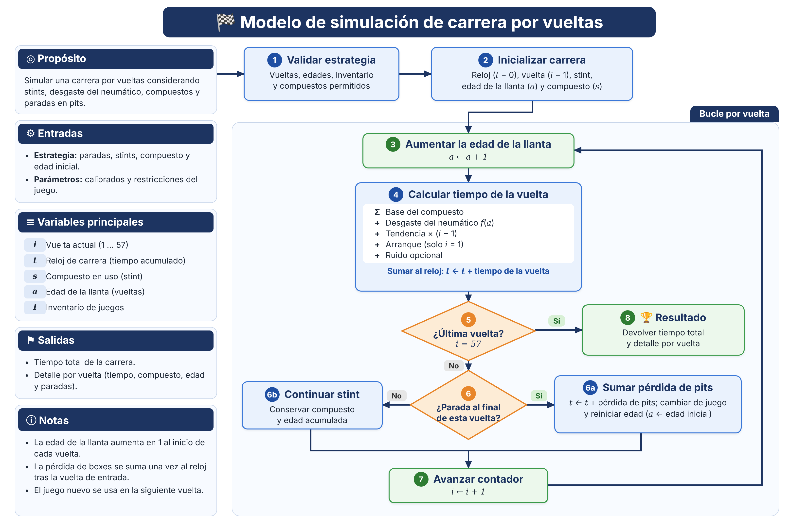
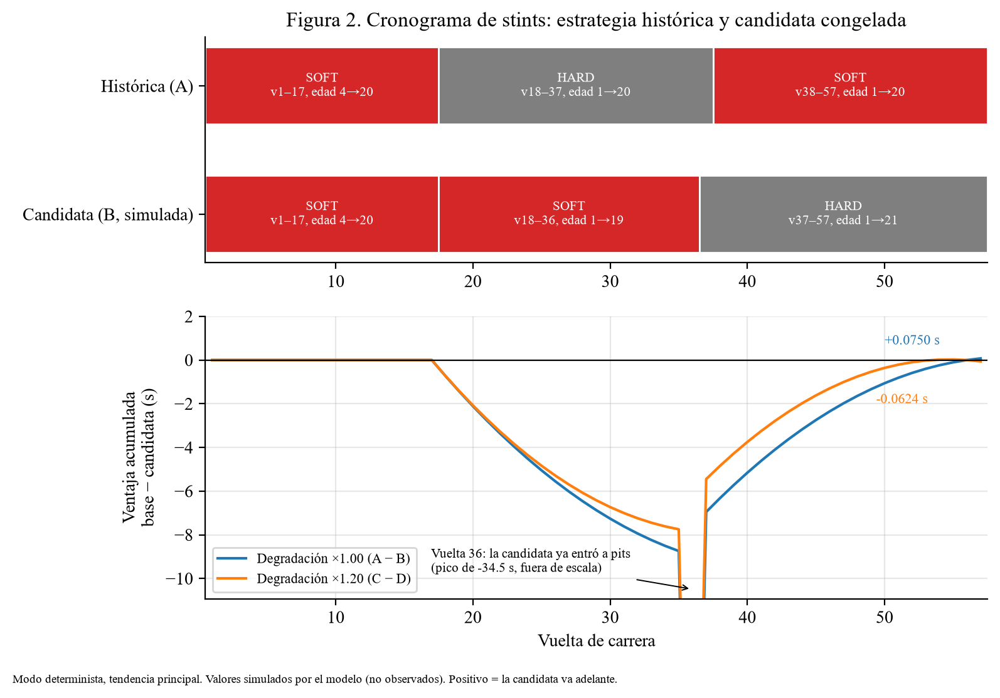
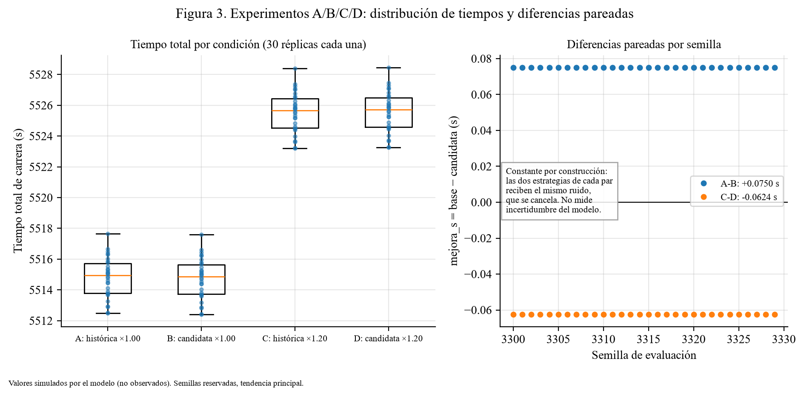
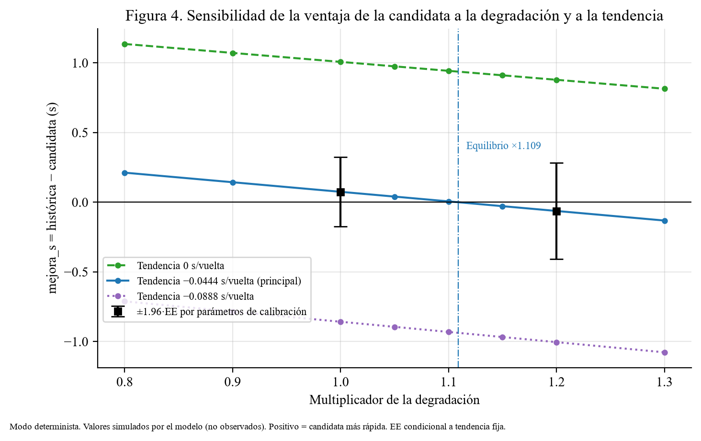
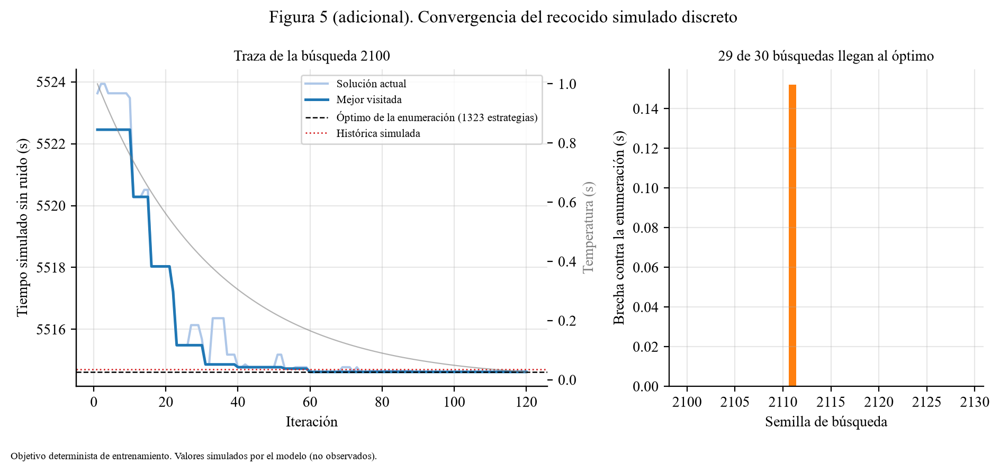

# Simulación y optimización de estrategias de paradas en boxes mediante recocido simulado (*simulated annealing*)

Mario Fernando Rocha – 23501
Jonathan Zacarias – 231104
Ihan Marroquin – 23108
Luis Pedro Lira – 23669
Luis Gilberto Marroquin - 23353

**Caso:** Max Verstappen (VER), Gran Premio de Bahréin 2024, carrera principal.
**Repositorio:** [https://github.com/Ihan-Marroquin/modsim_proyecto_final](https://github.com/Ihan-Marroquin/modsim_proyecto_final)
Guatemala, 9 de noviembre del 2026

> Integración editorial de Luis Gilberto Marroquin (LG-03). Cada sección resume el documento técnico de su autor, que sigue siendo la fuente con el detalle completo. Las cifras salen de `docs/evidence/` y las comprueba `tests/test_report_numbers.py`. Convenciones de signo en todo el informe: `error = predicho − observado` y `mejora_s = tiempo_base − tiempo_candidata` (positivo: la candidata es más rápida). Las columnas observadas solo contienen mediciones; los valores de la candidata son siempre simulados.

## Resumen

Se construyó un simulador por eventos discretos de una carrera de Fórmula 1, calibrado con 33 vueltas de entrenamiento de Verstappen en Bahréin 2024, y se le conectó un recocido simulado discreto que busca las vueltas de parada y la secuencia de neumáticos de menor tiempo esperado. El modelo se validó sin reajuste en el stint 3, reservado antes de calibrar: MAE de 0.712 s por vuelta, sesgo de +0.456 s (el modelo es más lento que la realidad) y error acumulado de +8.203 s en 18 vueltas. El recocido alcanzó el óptimo de la enumeración de 1323 estrategias factibles en 29 de 30 búsquedas. En el escenario principal, la candidata congelada (paradas en 17 y 36) es 0.075 s más rápida que la histórica simulada. La diferencia se invierte con +20 % de degradación (−0.062 s), cambia de signo según la tendencia de carrera (+1.007 / +0.075 / −0.857 s) y es menor que su error estándar por parámetros (0.128 s). **No se detectó una mejora robusta.** Con el límite estricto de edad, la candidata queda fuera y las seis estrategias factibles empatan con la histórica.

## 1. Problema y objetivos

*Redacción: Mario Fernando Rocha (MA-06), a partir de la propuesta del equipo y de docs/datos_openf1.md, docs/inventario_neumaticos.md y docs/calibracion.md.*

**Contexto.** En una carrera de Fórmula 1 en seco, la estrategia de neumáticos es una de las pocas decisiones que el equipo controla durante la carrera: en qué vueltas parar y qué juego montar en cada parada. Es un compromiso con dos fuerzas opuestas. Cada parada cuesta tiempo fijo: en este caso se estimaron 25.522 s, más de la cuarta parte de una vuelta de unos 95.6 s. Por otro lado, un neumático gastado pierde ritmo en cada vuelta: con los parámetros calibrados, unos 0.076 s por vuelta de edad en el SOFT y 0.105 s en el HARD, de modo que tras 20 vueltas un juego pierde entre 1.5 y 2.1 s por vuelta. Parar más seguido renueva el ritmo y paga más pérdida en pits. El reglamento además obliga a usar al menos dos especificaciones de neumático de seco (FIA, art. 30.5 l) y limita los juegos disponibles (art. 30.2 y 30.5).

**Justificación.** El problema encaja con el curso por tres razones:
1. Es un sistema con estados y eventos discretos: vuelta, juego montado, edad y reloj, con eventos de fin de vuelta, parada y bandera a cuadros.
2. Tiene variabilidad natural vuelta a vuelta que pide un modo estocástico con semillas y réplicas.
3. Su espacio de decisiones es combinatorio. Con el inventario reconstruido hay 1323 estrategias factibles en el escenario principal. Son demasiadas para compararlas a mano y justifican un método de búsqueda, pero son pocas para enumerarlas todas y comprobar si la búsqueda encuentra el óptimo.

Además, la pregunta se puede contrastar con la realidad: existe una estrategia histórica, un tiempo oficial de la FIA y datos públicos por vuelta.

**Por qué este caso.** Se eligió a Max Verstappen en el Gran Premio de Bahréin 2024 porque aísla el efecto de los neumáticos mejor que una carrera típica:
- Fue una carrera seca: lluvia 0 en las 157 muestras de clima.
- No hubo Safety Car ni VSC: ningún mensaje de esa categoría en control de carrera.
- Verstappen salió desde la pole y lideró con amplia ventaja, así que el tráfico pesa poco: ninguna bandera azul de las vueltas 41–46 fue para él.
- Hizo dos paradas con tres stints en dos compuestos.
- Los datos son públicos y se concilian al milisegundo con el total oficial (sección 2).

El costo de esta elección se declara desde el inicio. Con un piloto que administra una ventaja amplia, sus tiempos no muestran necesariamente el ritmo máximo, y con un solo stint por compuesto en entrenamiento la tendencia de carrera no se puede identificar (sección 3).

**Pregunta.** ¿Qué vueltas de parada y qué secuencia de neumáticos minimizan el tiempo esperado de carrera de un piloto, bajo las restricciones y supuestos estudiados?

**Unidad principal:** segundos de carrera, a minimizar. **Métricas secundarias:** MAE por vuelta, error acumulado, desviación estándar del tiempo simulado, mejora absoluta y porcentual, y número de estrategias factibles.

**Alcance comprometido:** un evento, un piloto, condiciones secas, estrategias de una o dos paradas, compuestos con datos suficientes, pérdida de tiempo en pits, evolución del ritmo y desgaste, e incertidumbre explícita. No se modelan interacción entre autos, decisiones de rivales, adelantamientos, lluvia ni Safety Car.

**Objetivos.**
1. Obtener y depurar datos públicos reproducibles del caso.
2. Formular y calibrar un modelo interpretable de tiempo por vuelta, separando entrenamiento y validación antes del ajuste.
3. Implementar un simulador determinista y estocástico con arranque, paradas y juegos usados.
4. Implementar recocido simulado discreto como técnica adicional y verificarlo contra una enumeración.
5. Validar el modelo con datos reservados y comparar la estrategia histórica con la candidata mediante experimentos pareados.

## 2. Datos

*Fuente: docs/datos_openf1.md, docs/filtro_calidad_openf1.md, docs/conciliacion_tiempos.md*

**Fuente.** OpenF1 (https://openf1.org), API pública no oficial con licencia CC BY-NC-SA 4.0. FastF1 3.9.2 no obtuvo tiempos sin autenticación en este entorno, así que OpenF1 es la vía comprobada. Se descargaron 57 vueltas de VER, 3 stints, 2 paradas, 157 registros de clima y 71 mensajes de control de carrera. OpenF1 no es una fuente oficial y no está asociada a Formula 1, así que se cita y se concilia contra la FIA. Los datos crudos no se versionan, por la licencia *ShareAlike*: cada clon los regenera con `python main.py download` y se comprueban con huellas SHA-256 portables. Las huellas normalizan los saltos de línea porque las de Windows y las de macOS diferían solo por eso.

**Condiciones de la carrera.** La lluvia fue 0 en las 157 muestras de clima. La pista se enfrió de 23.8 a 21.9 °C durante la carrera, que fue al atardecer. Hubo 0 mensajes de Safety Car o VSC. Solo hubo amarillas locales de un sector: una doble en la vuelta 1, que ya está fuera del ajuste, y una sencilla en las vueltas 10–11, sin pérdida medible. La documentación de OpenF1 declara que `date_start` es aproximado (se observó ±0.3 s), así que no sirve para conciliar diferencias menores a medio segundo. Por eso la conciliación se hizo vuelta a vuelta contra una segunda fuente.

**Referencia oficial.** La FIA registra 57 vueltas en 1:31:44.742 = 5504.742 s. La suma de vueltas de OpenF1 da 5505.217 s; la conciliación con Jolpica ubicó toda la diferencia (+0.475 s) en la vuelta 1, por la convención de inicio. Las vueltas 2–57 son iguales a Jolpica al milisegundo.

**Filtro de calidad propio.** OpenF1 no tiene las banderas `IsAccurate`, `Deleted` ni `TrackStatus` de FastF1, y no se inventan. El filtro `openf1-v1` usa control de carrera, pits y clima, no borra filas y deja 51 de 57 vueltas elegibles para el ajuste del ritmo normal. Quedan fuera del ajuste la vuelta 1 (salida desde parado), las de entrada y salida a pits (17, 18, 37 y 38) y la 46 (tiempo borrado por control de carrera).

**Partición congelada antes de calibrar** (`docs/particion_validacion.md`):

| Conjunto | Vueltas | Compuesto | Edades |
|---|---|---|---|
| Entrenamiento (33) | 2–16 y 19–36 | SOFT usado y HARD nuevo | SOFT 5–19, HARD 2–19 |
| Validación (18) | 39–57 sin la 46 (stint 3) | SOFT nuevo | 2–20 |
| Fuera del ajuste (6) | 1, 17, 18, 37, 38, 46 | — | — |

**Inventario de neumáticos** (`docs/inventario_neumaticos.md`). Con el art. 30 del Reglamento Deportivo FIA 2024 y los stints del fin de semana se infirieron 6 juegos disponibles para la carrera: SOFT, HARD y MEDIUM nuevos, y 3 de los 4 SOFT usados en la clasificación. MEDIUM queda fuera porque ningún piloto lo usó en la carrera y no hay datos para calibrarlo; es una limitación del proyecto, no una regla FIA. Así, la variante principal usa 5 juegos: SOFT 0, HARD 0, SOFT 3, SOFT 3 y SOFT 5 (edad inicial en vueltas). El inventario es inferido, no certificado por Pirelli. La regla de compuestos se cumple sin conocer la lista de especificaciones obligatorias del evento. El art. 30.5 l) exige dos especificaciones de seco, una de ellas obligatoria (art. 30.2 c ii). La carrera real de VER solo usó SOFT y HARD y fue válida, así que una de las dos era obligatoria. Toda estrategia del modelo usa ambas. Límites de edad del escenario principal: SOFT 21 y HARD 30 vueltas; con cobertura estricta (20 y 20) solo quedan 6 estrategias.

## 3. Modelo y simulador

*Fuente: docs/modelo_simulacion.md*

El simulador es de eventos discretos, con reloj continuo en segundos y eventos de fin de vuelta, parada/cambio de neumáticos y bandera a cuadros. Estados: vuelta, stint, compuesto, edad del juego y reloj acumulado.



**Diagrama 1.** Flujo del simulador por vuelta: actualización de edad, cálculo del tiempo, decisión de parada y condición de término en la vuelta 57.

**Vuelta normal:** `t_normal(l, c, a) = b_c + d_c · a · μ + g · (l − 1)`, donde `b_c` es el ritmo base del compuesto (s), `d_c` la degradación (s por vuelta de edad), `a` la edad al terminar la vuelta, `μ` el multiplicador de degradación (1.00 base, 1.20 en sensibilidad) y `g` la tendencia de carrera (s/vuelta).

**Vuelta en carrera:** `t_vuelta(l) = t_normal + Δ_arranque (solo l = 1) + ε_l`, con `ε_l ~ N(0, σ²)` en modo estocástico. En las vueltas con parada se suma la pérdida adicional de pits al terminar la vuelta de entrada. Esa pérdida agrupa el exceso de entrada y de salida, así que no se cuenta dos veces.

**Juegos usados.** Se conserva la edad inicial real: el SOFT del stint 1 llega con 3 vueltas de clasificación (edad 4 al terminar la vuelta 1 y 20 en la 17); el HARD y el SOFT siguientes son nuevos.

**Identificabilidad.** Con un stint por compuesto, la edad y la vuelta son colineales dentro de cada stint (rango 4 para 5 parámetros). Por eso la tendencia se fija con una referencia externa (TUM, Bahréin 2019): `g = −(0.023 s/kg × 1.93 kg/vuelta) = −0.0444 s/vuelta`, con sensibilidad a 0 y −0.0888 s/vuelta. No se eligió con datos de validación.

## 4. Calibración

*Fuente: docs/calibracion.md*

**Protocolo.** Antes de leer cualquier tiempo, la calibración comprueba que la partición coincide con su huella congelada y se detiene si no coincide. Después ajusta base y desgaste por compuesto con mínimos cuadrados ordinarios sobre `tiempo − g·(vuelta − 1)`, solo con las 33 vueltas de entrenamiento. La auditoría registra `validation_laps_read: []`. El arranque y la pérdida de pits se estiman aparte, con las vueltas 1, 17 y 18 y con la misma convención del simulador.

**Origen de la tendencia fija.** El valor viene del archivo de parámetros de Bahréin 2019 del simulador de TUM (Heilmeier et al., 2018), que también es una carrera de 57 vueltas. Ese archivo define `t_lap_sens_mass` = 0.023 s/kg, la sensibilidad del tiempo de vuelta a la masa, y `b_fuel_perlap` = 1.93 kg/vuelta, el consumo de combustible. En su código el término es `masa de combustible actual × t_lap_sens_mass`, y la masa baja 1.93 kg al final de cada vuelta. Por eso cada vuelta es 0.023 × 1.93 = 0.0444 s más rápida. Solo se tomaron esos dos números, no se reutilizó código. Son autos de 2019 y el valor representa solo el combustible, no la evolución de la pista, así que se acompaña de dos escenarios de sensibilidad: 0 y el doble.

Escenario principal `trend_fuel_reference`:

| Parámetro | Estimación | Error estándar | IC 95 % |
|---|---:|---:|---|
| SOFT base (s) | 96.414 | 0.153 | 96.084 – 96.744 |
| SOFT desgaste (s/vuelta) | 0.0761 | 0.0120 | 0.050 – 0.102 |
| HARD base (s) | 95.652 | 0.067 | 95.511 – 95.793 |
| HARD desgaste (s/vuelta) | 0.1052 | 0.0057 | 0.093 – 0.117 |
| Dispersión residual σ (s) | 0.163 | | 33 vueltas |
| Penalización de arranque (s) | 0.566 | | 1 observación |
| Pérdida adicional por parada (s) | 25.522 | | parada de la vuelta 17 |

La segunda parada (37–38) se dejó sin usar para comprobarla en la validación. Las tres tendencias producen exactamente el mismo ajuste en entrenamiento: misma dispersión, arranque y pérdida de pits. Los datos no pueden elegir entre ellas, y por eso la elección pesa en las estrategias y en el stint 3, no en la calidad del ajuste.

Resultados contraintuitivos que no se corrigieron: el HARD tiene base más rápida y más desgaste que el SOFT en el escenario principal. Hay tres causas posibles, sin verificar:
- La tendencia de referencia omite la evolución de la pista, que afecta más al stint 1.
- VER administró el ritmo al inicio.
- El SOFT del stint 1 era un juego usado en clasificación. La autocorrelación de orden 1 de los residuos es 0.21 en SOFT y 0.00 en HARD; el modo estocástico supone independencia.

## 5. Técnica adicional: recocido simulado discreto

*Fuente: docs/tecnica_recocido.md*

**Representación.** Un estado son las vueltas de parada y una secuencia de juegos (compuesto y edad inicial) tomada del inventario, con cada juego usado como máximo una vez. El catálogo tiene 0 estrategias de una parada (una parada cubriría como mucho 51 de las 57 vueltas) y 1323 de dos paradas.

**Algoritmo.** Estado inicial aleatorio con semilla; vecinos que desplazan una parada ±1, ±2 o ±3 vueltas o cambian la secuencia de juegos (95 %), y saltos uniformes al catálogo completo (5 %). Se acepta toda mejora y un empeoramiento Δ con probabilidad `exp(−Δ/T)` (criterio de Metropolis, Kirkpatrick et al., 1983). Enfriamiento geométrico hasta 10⁻⁶ s. El objetivo es el tiempo determinista del simulador con los parámetros de entrenamiento.

**Pilotos y búsqueda.** Cuatro perfiles con las semillas piloto 1100–1109; todos llegaron al óptimo en 10/10 y se eligió el compacto (120 propuestas, T inicial 1 s, factor 0.97) por usar menos simulaciones (unas 63 en promedio). Con él se corrieron 30 búsquedas (semillas 2100–2129): **29 de 30 alcanzaron el mínimo de la enumeración**; la mayor brecha fue 0.1522 s.

| Estrategia | Paradas tras la vuelta | Juegos (edad inicial) | Tiempo determinista simulado (s) |
|---|---|---|---:|
| Histórica | 17, 37 | SOFT (3), HARD (0), SOFT (0) | 5514.6992 |
| Candidata congelada (semilla 2100) | 17, 36 | SOFT (3), SOFT (0), HARD (0) | 5514.6242 |

**Alternativas y límites.** Para este caso, la enumeración exacta de 1323 estrategias es práctica y sirvió de referencia; el recocido aporta cuando el espacio crece. Hill Climbing no acepta empeoramientos y queda atrapado en mínimos locales; un genético necesitaría operadores y reparación de restricciones para una población. El enfriamiento finito no garantiza el óptimo global (Hajek, 1988), y la búsqueda puede favorecer zonas donde el modelo es débil (por ejemplo, edades extrapoladas).

## 6. Validación en el stint 3 reservado

*Fuente: docs/validacion_experimentos.md, secciones 4 y 5.5*

Estrategia histórica, modo determinista, parámetros congelados, sin reajuste. Vueltas 2–57 de OpenF1 y vuelta 1 con la convención oficial.

| Conjunto | Vueltas | MAE (s) | Sesgo (s) | Error acumulado (s) |
|---|---:|---:|---:|---:|
| `validation_all` (número principal) | 18 | 0.712 | +0.456 | +8.203 |
| `validation_covered_ages` (edad 5–19) | 14 | 0.570 | +0.531 | +7.431 |
| `validation_extrapolated_ages` (edad 2–4 y 20) | 4 | 1.206 | +0.193 | +0.772 |

El modelo predice el stint 3 sistemáticamente más lento que lo observado. En edades cubiertas, el MAE es 4.8 veces el de entrenamiento (0.118 s). El mayor error es +2.27 s en la vuelta 39, vuelta rápida de la carrera (Figura 1).

**Reconstrucción de las 57 vueltas (no es validación).** Total simulado 5514.699 s contra 5504.742 s de la FIA: +9.957 s. Los tramos 1–36 casi no tienen error porque se ajustaron con ellos; el error está en la parada 37–38 (+0.848 s) y en el stint 3 (+9.111 s).

**Segunda parada.** Pérdida implícita 24.674 s contra 25.522 s calibrada. La FIA registra 25.064 y 24.209 s en pit lane para las dos paradas, una diferencia de 0.855 s, del mismo orden que la discrepancia.

**Sensibilidad a la tendencia (no se usó para elegir):**

| Escenario | Tendencia (s/vuelta) | MAE (s) | Sesgo (s) | Acumulado (s) | Reconstrucción − FIA (s) |
|---|---:|---:|---:|---:|---:|
| `trend_zero` | 0 | 2.232 | +2.232 | +40.171 | +45.477 |
| `trend_fuel_reference` | −0.0444 | 0.712 | +0.456 | +8.203 | +9.957 |
| `trend_double` | −0.0888 | 1.375 | −1.320 | −23.765 | −25.563 |

## 7. Experimentos A/B/C/D

*Fuente: docs/validacion_experimentos.md, sección 5*

| Condición | Estrategia | Degradación | Réplicas | Semillas |
|---|---|---:|---:|---|
| A | Histórica | ×1.00 | 30 | 3300–3329 |
| B | Candidata congelada | ×1.00 | 30 | 3300–3329 |
| C | Histórica | ×1.20 | 30 | 3300–3329 |
| D | La misma candidata de B | ×1.20 | 30 | 3300–3329 |

Las semillas de evaluación no se usaron en pilotos (1100–1109) ni en la búsqueda (2100–2129). A/B y C/D comparten la semilla de cada réplica. El ruido es gaussiano aditivo por vuelta con σ = 0.1631 s. El +20 % es un escenario hipotético, no un dato observado.

| Condición | Determinista (s) | Media de 30 (s) | DE (s) | IC 95 % de la media (s) |
|---|---:|---:|---:|---|
| A | 5514.699 | 5514.810 | 1.303 | 5514.323 – 5515.297 |
| B | 5514.624 | 5514.735 | 1.303 | 5514.248 – 5515.222 |
| C | 5525.419 | 5525.529 | 1.303 | 5525.043 – 5526.016 |
| D | 5525.481 | 5525.592 | 1.303 | 5525.105 – 5526.079 |

| Par | mejora_s | mejora_% | Réplicas con la candidata más rápida |
|---|---:|---:|---:|
| A − B (×1.00) | +0.0750 | +0.00136 % | 30 / 30 |
| C − D (×1.20) | −0.0624 | −0.00113 % | 0 / 30 |

**Por qué la diferencia pareada es constante.** Con la misma semilla, ambas estrategias reciben las mismas 57 perturbaciones y el ruido se cancela: la DE pareada es del orden de 10⁻¹² s (redondeo). Por eso «30 de 30» no es evidencia estadística y esa dispersión no mide la incertidumbre del modelo (Figura 3).

**De dónde sale la diferencia.** El modelo es lineal, así que `mejora_s = (b_SOFT − b_HARD) + μ · (20 · d_SOFT − 21 · d_HARD) = 0.7622 − 0.6872 · μ`. La tendencia y la pérdida de pits se cancelan (57 vueltas y dos paradas en ambas). El equilibrio está en μ = ×1.109.

**Incertidumbre por parámetros de calibración** (propagación del error estándar de MA-04, condicional a tendencia fija):

| Multiplicador | mejora_s | EE (s) | IC 95 % aproximado (s) |
|---|---:|---:|---|
| ×1.00 | +0.075 | 0.128 | −0.175 – +0.325 |
| ×1.20 | −0.062 | 0.176 | −0.408 – +0.283 |

**Sensibilidad** (determinista, `sensibilidad.csv`; Figura 4):

| Tendencia | ×0.80 | ×1.00 | ×1.10 | ×1.20 | ×1.30 |
|---|---:|---:|---:|---:|---:|
| `trend_zero` | +1.136 | +1.007 | +0.943 | +0.879 | +0.815 |
| `trend_fuel_reference` | +0.212 | +0.075 | +0.006 | −0.062 | −0.131 |
| `trend_double` | −0.711 | −0.857 | −0.931 | −1.004 | −1.077 |

Con cobertura estricta (edad ≤ 20) la candidata es infactible (HARD llega a edad 21 en la vuelta 57) y los seis órdenes factibles empatan con la histórica.

## 8. Comparación con la carrera real

| Métrica, 57 vueltas (s) | Observado (FIA) | Histórica simulada (A) | Candidata simulada (B) |
|---|---:|---:|---:|
| Tiempo total, determinista | 5504.742 | 5514.699 | 5514.624 |
| Tiempo total, media de 30 réplicas | — | 5514.810 | 5514.735 |
| Simulado − observado | — | +9.957 | No comparable: estrategia no observada |
| Error acumulado en el stint 3 reservado | — | +8.203 | — |

La ventaja estimada de 0.075 s equivale al 0.0014 % del tiempo de carrera. Es 6 veces menor que el sesgo de una sola vuelta en validación (0.456 s), 11 veces menor que la discrepancia de la segunda parada (0.85 s), unas 110 veces menor que el error acumulado del stint reservado (8.2 s) y menor que su propio error estándar (0.128 s).

## 9. Resultados en figuras

Todas las figuras se generan con `python main.py figures` desde los CSV y JSON de evidencia (`src/visualization.py`); ningún número se escribe a mano.


**Figura 1.** Tiempos observados y predichos por vuelta. El área sombreada es el stint 3 reservado; abajo, el error por vuelta (naranja: edades extrapoladas) y el error acumulado hasta +8.203 s. Fuente: OpenF1 y Jolpica (CC BY-NC-SA 4.0). Esta figura se regenera con `validate` y no se versiona.



**Figura 2.** Cronograma de stints de la histórica y la candidata, y ventaja acumulada base − candidata por vuelta. La candidata pierde tiempo en el stint SOFT intermedio y lo recupera en el HARD final; termina +0.0750 s adelante con ×1.00 y −0.0624 s con ×1.20.



**Figura 3.** Distribución del tiempo total en las 30 réplicas de cada condición y diferencias pareadas por semilla, constantes por construcción.



**Figura 4.** Ventaja de la candidata según el multiplicador de degradación y la tendencia de carrera, con el intervalo ±1.96·EE por parámetros. La ventaja cruza cero en ×1.109 y cambia de signo según la tendencia.



**Figura 5 (adicional).** Traza del recocido de la semilla 2100 frente al óptimo de la enumeración y brecha de las 30 búsquedas.

## 10. Conclusiones

1. El modelo obtuvo un MAE de entrenamiento de 0.118 s por vuelta. En las 18 vueltas reservadas del stint 3, el MAE fue de 0.712 s, con un sesgo de +0.456 s por vuelta y un error acumulado de +8.203 s. La reconstrucción completa (+9.957 s respecto de la FIA) incluye las vueltas usadas en el ajuste.
2. El recocido simulado discreto funciona y está verificado: encontró el óptimo de la enumeración en 29 de 30 búsquedas con unas 67 simulaciones por búsqueda.
3. **No se detectó una mejora robusta.** En el escenario principal, con degradación nominal y límite de edad amplio, la candidata aventaja a la histórica simulada por 0.075 s. La ventaja se invierte con +20 % de degradación, cambia de signo al variar la tendencia y es menor que su error estándar por parámetros (0.128 s).
4. Con el límite estricto de edad, la candidata deja de ser factible y las seis estrategias permitidas empatan con la histórica. Recomendamos conservar la histórica como referencia y validar con más carreras y varios stints por compuesto antes de proponer cambios en pista.

## 11. Limitaciones

1. Ruido aditivo, gaussiano, independiente e igual para ambos compuestos; con semillas compartidas se cancela.
2. El EE por parámetros supone tendencia fija, normalidad e independencia (SOFT con autocorrelación 0.21) y no incluye el error de especificación.
3. La tendencia de carrera no es identificable con un stint por compuesto; el signo de la ventaja depende de ella.
4. Validación pequeña: 18 vueltas de un mismo stint, de un piloto en una carrera, con ritmo administrado y la vuelta rápida en la 39.
5. Pérdida de pits fija, desgaste lineal sin *cliff*, sin tráfico, rivales ni Safety Car; inventario inferido; MEDIUM excluido.
6. La candidata usa HARD hasta edad 21 en una fase de carrera que el HARD nunca corrió con VER: es extrapolación.
7. Transparencia: el equipo vio los tiempos del stint 3 durante la revisión de datos, antes de congelar la partición; los parámetros y la tendencia se fijaron sin ellos y nada se reajustó después.

## 12. Reproducibilidad

```bash
python -m venv .venv
.venv/Scripts/python.exe -m pip install -r requirements.txt   # macOS/Linux: .venv/bin/python
python -m unittest discover -s tests
python main.py simulate                       # histórica, sin internet
python main.py optimize                       # pilotos, 30 búsquedas y candidata
python main.py compare                        # histórica contra candidata
python main.py replay                         # reproducción interactiva, sin internet
python main.py experiments                    # 120 réplicas A/B/C/D
python main.py download                       # OpenF1 (internet)
python main.py reconcile
python main.py partition
python main.py validate                       # stint 3 reservado
python main.py figures                        # figuras en report/figures/
```

`optimize` y `experiments` regeneran archivos idénticos a los de `docs/evidence/` salvo el fin de línea (comprobado el 2026-11-08).

## 13. Contribuciones y uso de IA

| Integrante | Aporte principal | Documento |
|---|---|---|
| Mario Fernando Rocha | Datos OpenF1, filtro de calidad, conciliación, partición, inventario y calibración (MA-01 a MA-05) | `docs/datos_openf1.md`, `docs/calibracion.md` y relacionados |
| Jonathan Zacarias | Formulación, simulador determinista/estocástico, arranque y pits (JO-01 a JO-03) | `docs/modelo_simulacion.md` |
| Ihan Marroquin | Base del repositorio, recocido discreto, pilotos, 30 búsquedas y candidata (BASE, IH-01 a IH-06) | `docs/tecnica_recocido.md` |
| Luis Pedro Lira | Revisión de la partición, pruebas, validación, experimentos A/B/C/D y análisis (LP-01 a LP-06) | `docs/validacion_experimentos.md` |
| Luis Gilberto Marroquin | Figuras desde evidencia, comando de comparación, integración del informe, demo y guion (LG-01 a LG-04) | `src/visualization.py`, `report/`, `presentation/` |

El detalle por fecha, archivos y revisiones está en `docs/CONTRIBUCIONES.md`. Uso de IA: Codex asistió a Ihan; Claude Code asistió a Mario, Luis Pedro y Luis Gilberto; Antigravity asistió a Jonathan. Todas las pruebas, búsquedas, validaciones y experimentos se ejecutaron y su evidencia está versionada.

## Referencias

1. OpenF1. *OpenF1 API documentation*. https://openf1.org/docs/ (CC BY-NC-SA 4.0).
2. FIA. *2024 Bahrain Grand Prix – Race Classification*. https://www.fia.com/events/fia-formula-one-world-championship/season-2024/bahrain-grand-prix/race-classification
3. FIA. *2024 Formula 1 Sporting Regulations*, Issue 5, 28-02-2024, art. 30. https://api.fia.com/sites/default/files/fia_2024_formula_1_sporting_regulations_-_issue_5_-_2024-02-28.pdf (art. 30.2 y 30.5 comprobados en el texto el 2026-11-09).
4. Kirkpatrick, S., Gelatt, C. D. y Vecchi, M. P. (1983). Optimization by Simulated Annealing. *Science*, 220(4598), 671–680. https://doi.org/10.1126/science.220.4598.671
5. Hajek, B. (1988). Cooling Schedules for Optimal Annealing. *Mathematics of Operations Research*, 13(2), 311–329.
6. Heilmeier, A., Graf, M. y Lienkamp, M. (2018). A Race Simulation for Strategy Decisions in Circuit Motorsports. *IEEE ITSC*. https://doi.org/10.1109/itsc.2018.8570012. Parámetros `t_lap_sens_mass` y `b_fuel_perlap` tomados de `racesim/input/parameters/pars_Sakhir_2019.ini` y uso comprobado en `racesim/src/combustioncar.py`, repositorio https://github.com/TUMFTM/race-simulation (LGPL-3.0), consultado el 2026-11-09.
7. Jolpica F1 API (sucesora de Ergast), https://github.com/jolpica/jolpica-f1 (datos CC BY-NC-SA 4.0), consultada el 2026-11-06. Se usó para conciliar la vuelta 1 con la convención oficial.
